# Ryco Spices — Fullstack Export Sample Tracking Platform (Bab 9: NestJS Dasar + Struktur MVC)

**Ryco Spices** adalah platform perdagangan digital B2B untuk eksportir rempah Indonesia (Maluku & Sulawesi) yang menghubungkan informasi katalog ekspor dengan sistem operasional pengiriman sampel internasional. Pada tahap **Bab 9 (NestJS Dasar + Struktur MVC)**, repository ini melanjutkan proyek fullstack React sebelumnya (`Project-PPW`) dengan menambahkan backend REST API berbasis **NestJS** yang terhubung langsung ke aplikasi frontend **`ryco-sample-portal`**.

---

## 1. Data Utama & Arsitektur MVC Backend

- **Data Utama (Resource)**: `samples` — **Permintaan Sampel Ekspor Rempah B2B** (`SMPL-101`, `SMPL-102`, dst.).
- **Pola Arsitektur**: **MVC / Modular NestJS**:
  - **Model / Entity**: `ryco-backend/src/samples/entities/sample.entity.ts` (`Sample`, `SampleStatus`, `VALID_COMMODITIES`, `VALID_GRADES`)
  - **DTO & Validasi**: `ryco-backend/src/samples/dto/create-sample.dto.ts` dan `update-sample.dto.ts` menggunakan `class-validator` + `class-transformer` + `@nestjs/mapped-types`
  - **Service (Business Logic & In-Memory Store)**: `ryco-backend/src/samples/samples.service.ts`
  - **Controller (HTTP Routing & Dependency Injection)**: `ryco-backend/src/samples/samples.controller.ts`
  - **View (Frontend Client)**: `ryco-sample-portal/` (React + Vite) terhubung via `src/services/samplesApi.js`

---

## 2. Struktur Direktori

```text
Project-PPW-NestJS/
├── README.md
├── docs/
│   └── screenshots/                  # 14 screenshot tahapan CLI, REST Client, & Integrasi Fullstack
├── ryco-backend/                     # Backend NestJS (Port 3000)
│   ├── requests/
│   │   └── samples.http              # Koleksi pengujian REST Client (CRUD + Error Cases)
│   └── src/
│       ├── main.ts                   # Global ValidationPipe + CORS + Bootstrap
│       ├── app.module.ts
│       └── samples/
│           ├── dto/
│           │   ├── create-sample.dto.ts
│           │   └── update-sample.dto.ts
│           ├── entities/
│           │   └── sample.entity.ts
│           ├── samples.controller.ts
│           ├── samples.controller.spec.ts
│           ├── samples.module.ts
│           ├── samples.service.ts
│           └── samples.service.spec.ts
├── ryco-sample-portal/               # Frontend Operasional Sample Portal (Port 5174)
│   └── src/
│       ├── services/samplesApi.js    # Fetch client ke http://localhost:3000/samples
│       ├── components/               # Header, StatsSummary, SampleForm, SampleList, SampleCard, SampleDetailModal, EmptyState
│       └── App.jsx
└── ryco-spices-react/                # Aplikasi Publik Katalog & Profil Perusahaan (Port 5173)
```

---

## 3. Desain Entity, DTO Validasi, dan Exception Handling

### A. Entity `Sample` (`sample.entity.ts`)
Menggunakan lebih dari 5 field dengan tipe data bervariasi:
- `id` (`string`), `buyerName` (`string`), `companyName` (`string`), `email` (`string`), `phone` (`string`), `country` (`string`), `city` (`string`), `postalCode` (`string`), `shippingAddress` (`string`), `courierService` (`string`), `trackingAwb` (`string`), `commodity` (`string`), `grade` (`string`)
- `weightGrams` (`number`) — berat fisik sampel dalam gram (`250`, `500`, `1000`, `2000`)
- `requiresCoa` (`boolean`) — status kewajiban lampiran sertifikat uji laboratorium (COA)
- `requestDate` (`string` ISO date `YYYY-MM-DD`) & `createdAt` (`string` ISO timestamp)
- `status` (`enum SampleStatus`: `'Pending Review' | 'Shipped / Dispatched' | 'Delivered'`)

### B. Validasi DTO & Global `ValidationPipe`
Diaktifkan secara global di `src/main.ts` (`whitelist: true`, `forbidNonWhitelisted: true`, `transform: true`) dengan aturan `class-validator`:
- `@IsString()`, `@IsNotEmpty()`, `@MinLength(3)` / `@MinLength(10)` pada `buyerName`, `companyName`, `shippingAddress`
- `@IsIn(VALID_COMMODITIES)` & `@IsIn(VALID_GRADES)` pada komoditas dan grade ekspor
- `@Type(() => Number)`, `@IsInt()`, `@Min(100)`, `@Max(10000)` pada `weightGrams`
- `@IsOptional()`, `@IsEmail()`, `@IsBoolean()`, `@IsDateString()`, `@IsEnum(SampleStatus)` pada field opsional & pembaruan (`UpdateSampleDto extends PartialType(CreateSampleDto)`)

### C. Penanganan Error (Built-in NestJS Exceptions)
1. **`NotFoundException` (404)**: Saat `GET /samples/:id`, `PATCH /samples/:id`, atau `DELETE /samples/:id` dipanggil dengan ID yang tidak ditemukan (misal `SMPL-999`).
2. **`ConflictException` (409)**: Saat membuat atau memperbarui data dengan nomor resi `trackingAwb` duplikat, atau membuat permintaan sampel aktif (`Pending Review`) ganda untuk perusahaan, komoditas, dan grade yang sama.
3. **`BadRequestException` (400)**: Saat payload DTO melanggar validasi `ValidationPipe` atau payload `PATCH` kosong.

---

## 4. Daftar Endpoint REST API

| Method | Endpoint | Deskripsi | Status Sukses |
| :--- | :--- | :--- | :--- |
| `GET` | `/samples` | Mengambil seluruh daftar permintaan sampel (mendukung query `?commodity=`, `?status=`, `?search=`) | `200 OK` |
| `GET` | `/samples/:id` | Mengambil detail satu permintaan sampel berdasarkan ID | `200 OK` |
| `POST` | `/samples` | Menambahkan permintaan sampel ekspor baru | `201 Created` |
| `PATCH` | `/samples/:id` | Memperbarui sebagian data / status / catatan dispatch sampel | `200 OK` |
| `DELETE` | `/samples/:id` | Menghapus permintaan sampel berdasarkan ID | `200 OK` |
| `POST` | `/samples/reset` | Mengembalikan 4 data awal B2B ke memori | `200 OK` |

---

## 5. Cara Menjalankan Aplikasi (Fullstack)

### 1. Jalankan Backend NestJS (`http://localhost:3000`)
```bash
cd ryco-backend
npm install
npm run start:dev
```
Untuk menjalankan unit test & e2e test backend:
```bash
cd ryco-backend
npm test
npm run test:e2e
```

### 2. Jalankan Frontend Portal Sampel (`http://localhost:5174`)
```bash
cd ryco-sample-portal
npm install
npm run dev -- --port 5174
```

*(Opsional) Jalankan aplikasi website publik pada port `5173`:*
```bash
cd ryco-spices-react
npm install
npm run dev -- --port 5173
```

---

## 6. Dokumentasi Screenshot Setiap Tahapan

### Tahap 1 — Pembuatan Resource dengan Nest CLI & Bootstrap Server
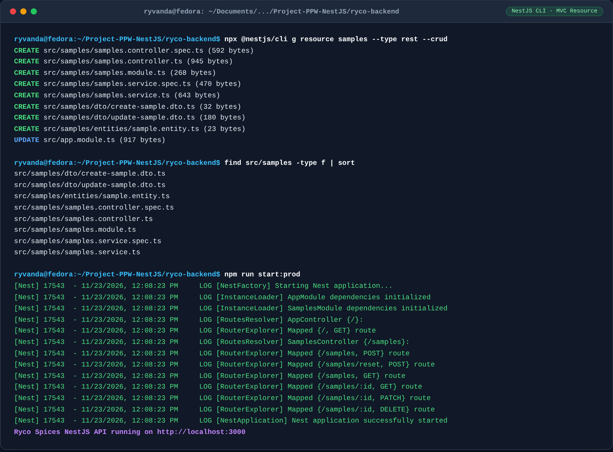

### Tahap 2 — Pengujian Endpoint via REST Client (`ryco-backend/requests/samples.http`)

#### `GET /samples` (200 OK)
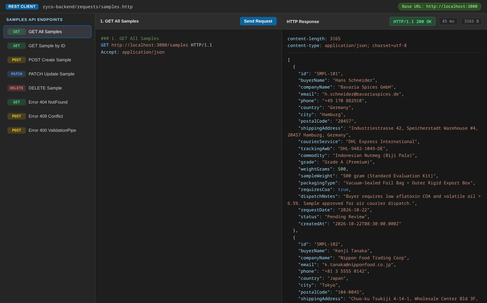

#### `GET /samples/SMPL-101` (200 OK)
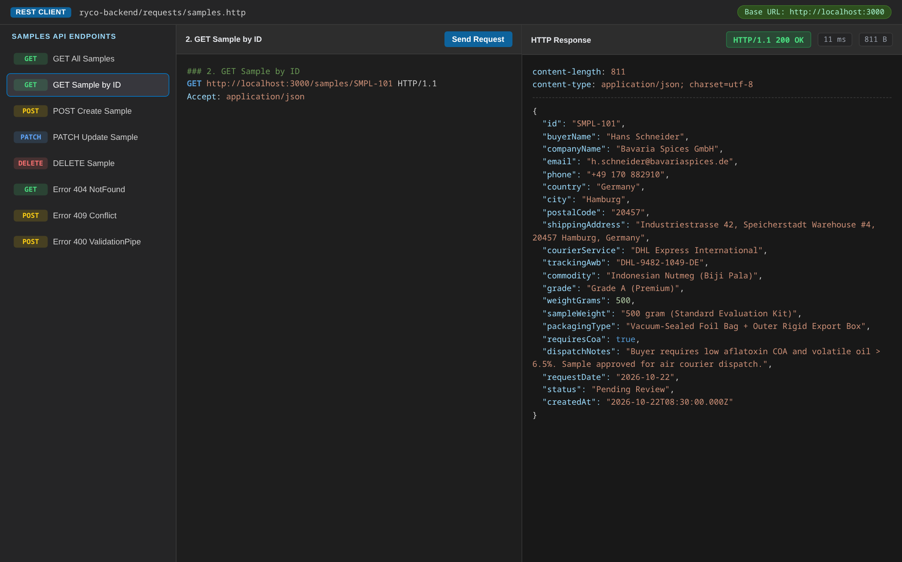

#### `POST /samples` (201 Created)
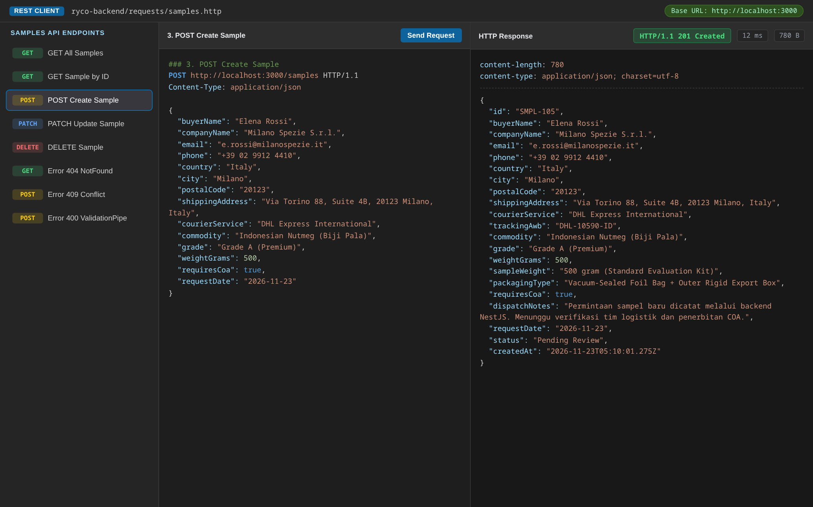

#### `PATCH /samples/SMPL-105` (200 OK)
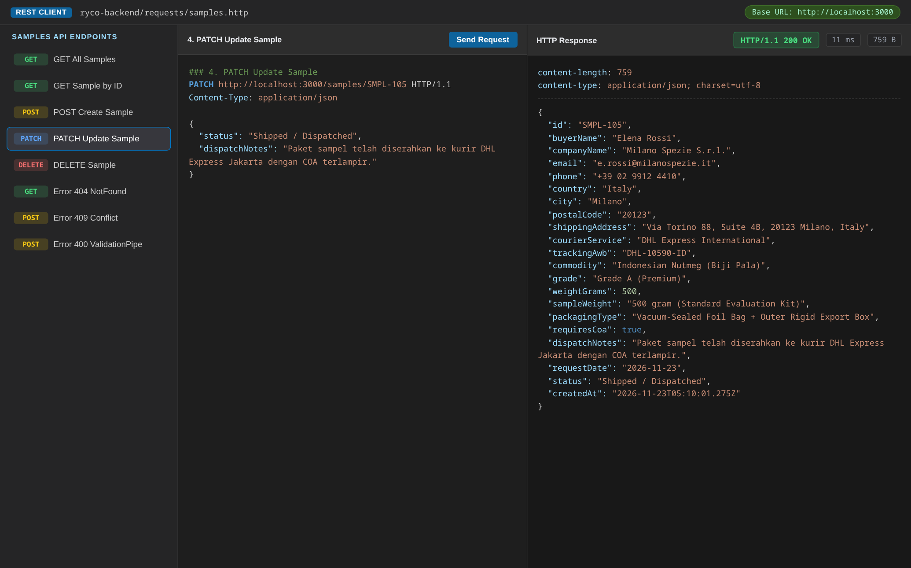

#### `DELETE /samples/SMPL-105` (200 OK)
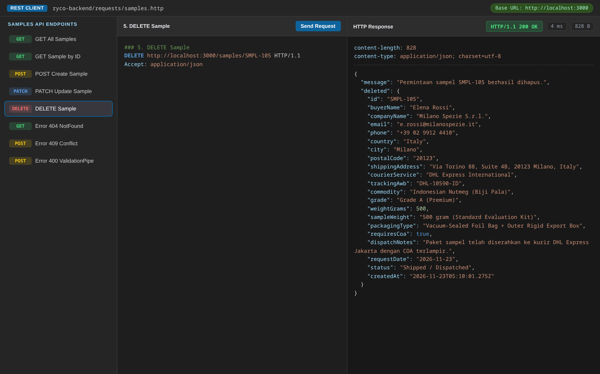

### Tahap 3 — Pengujian Skenario Error Handling (404, 409, 400)

#### `NotFoundException` — `GET /samples/SMPL-999` (404 Not Found)
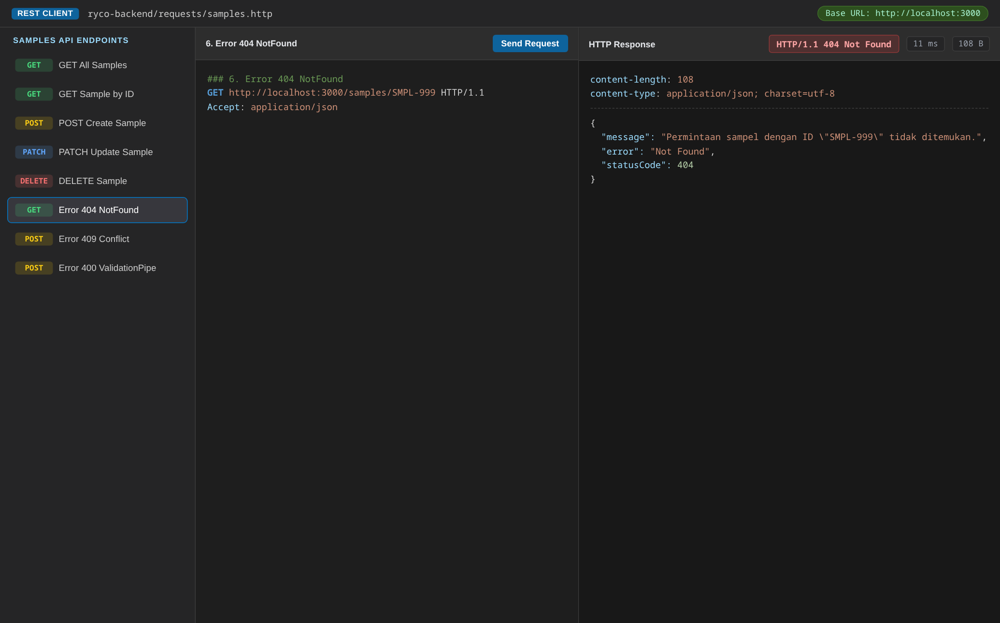

#### `ConflictException` — Duplicate Tracking AWB (409 Conflict)
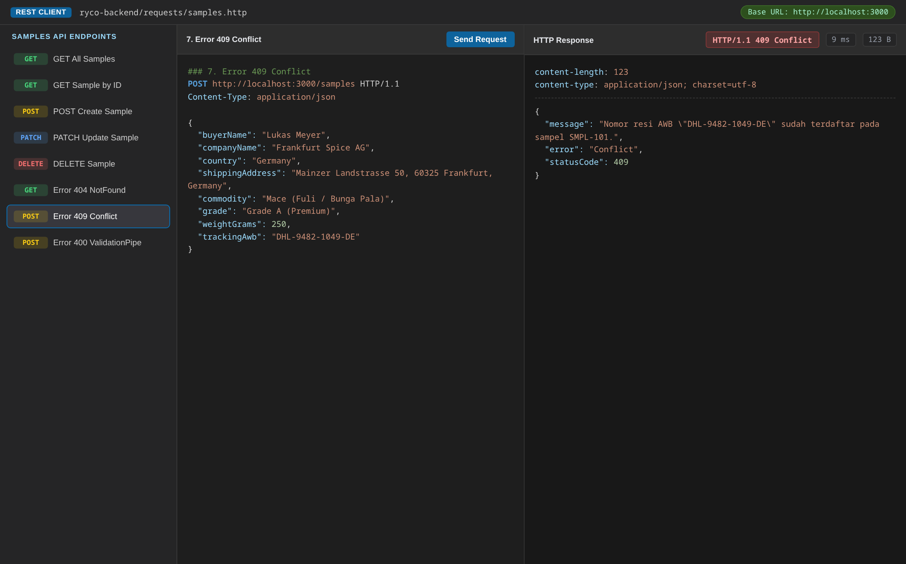

#### Global `ValidationPipe` — DTO Invalid Payload (400 Bad Request)
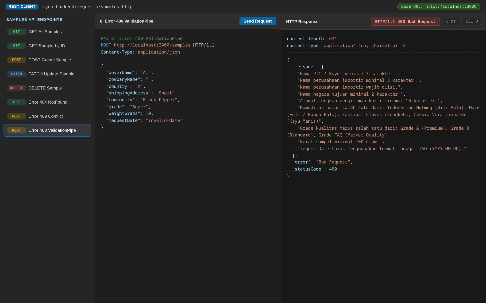

### Tahap 4 — Integrasi Fullstack Frontend (`ryco-sample-portal`) + Backend (`ryco-backend`)

#### 1. Halaman Monitoring Terhubung ke NestJS API (`GET /samples`)
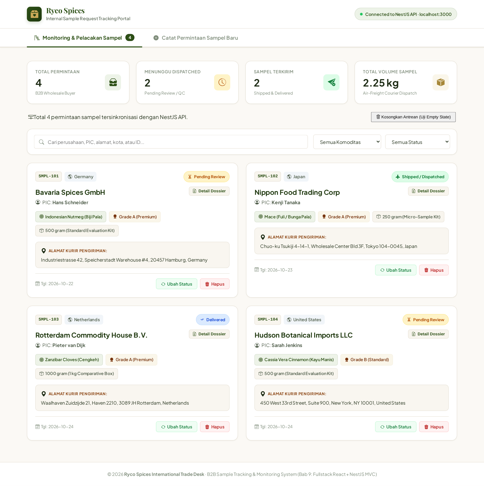

#### 2. Form Tambah Permintaan Sampel Baru
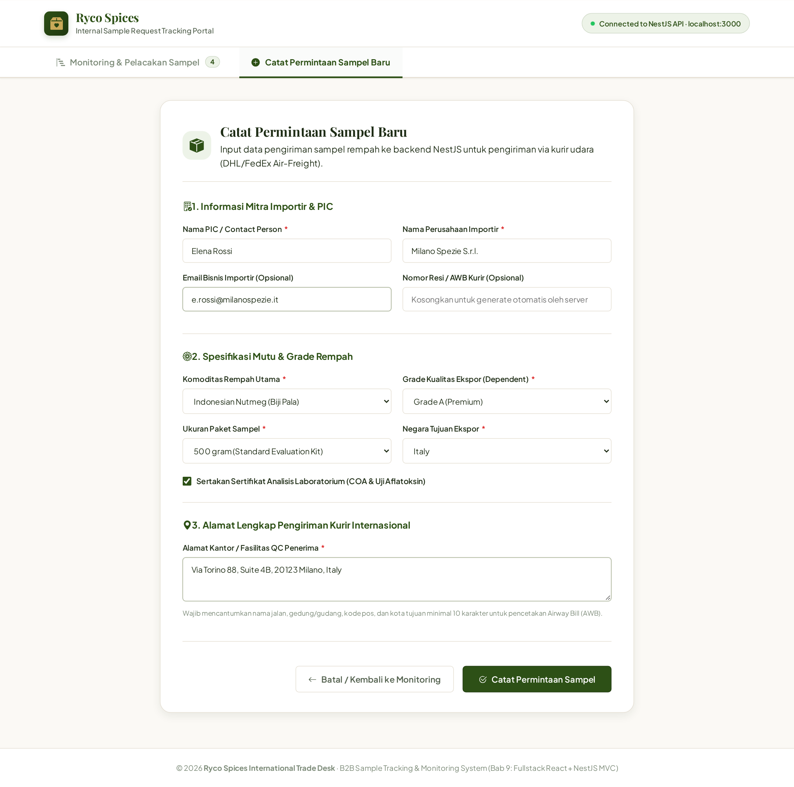

#### 3. Hasil Setelah Menambah Data (`POST /samples` -> `SMPL-105`)
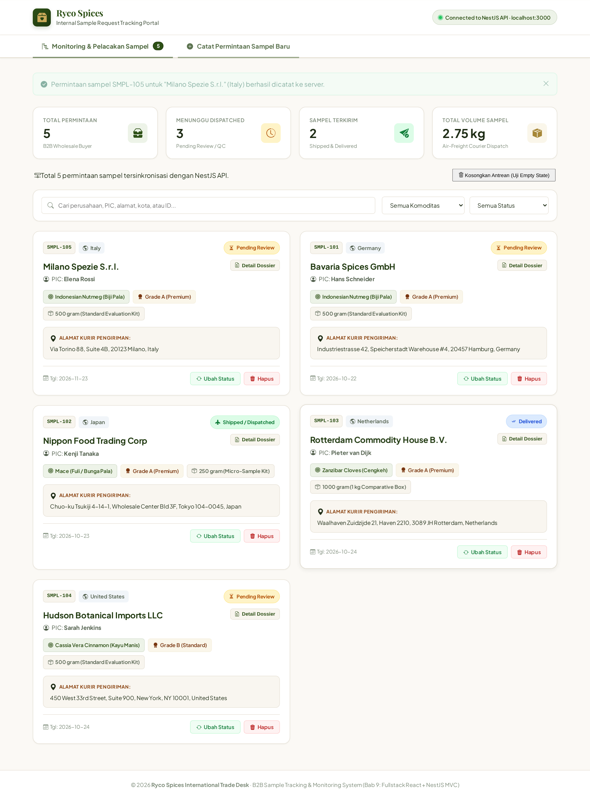

#### 4. Hasil Setelah Mengubah Status via Detail Dossier (`PATCH /samples/SMPL-105`) & Reload Halaman
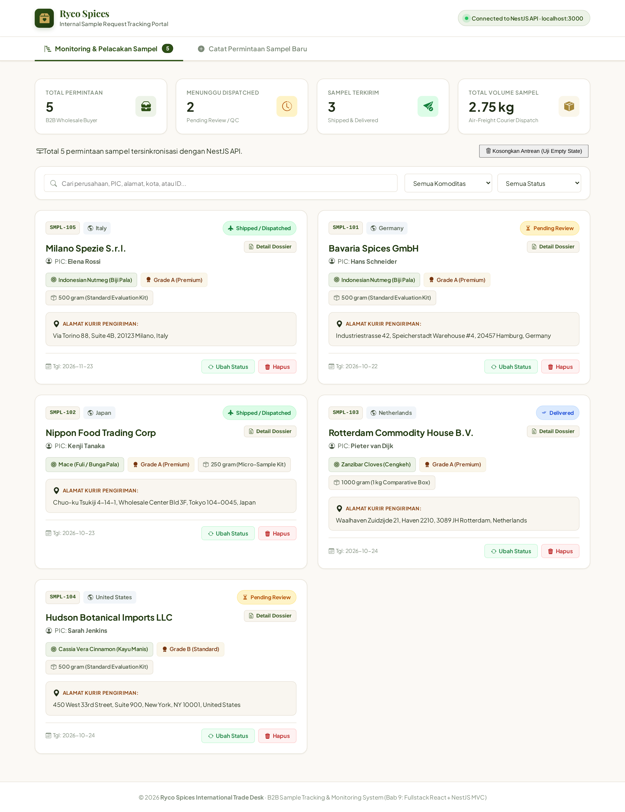

#### 5. Hasil Setelah Menghapus Data (`DELETE /samples/SMPL-105`)
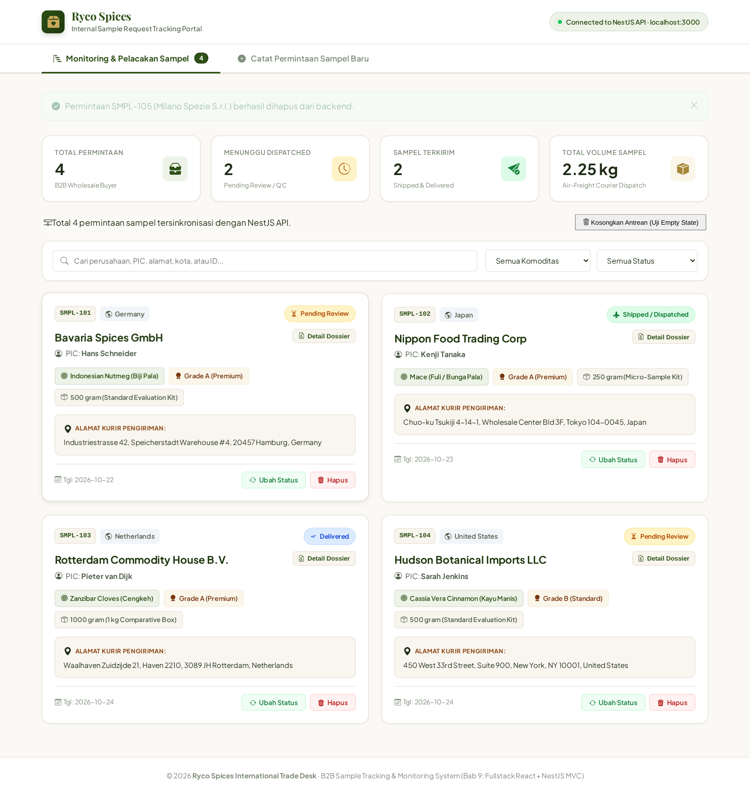
